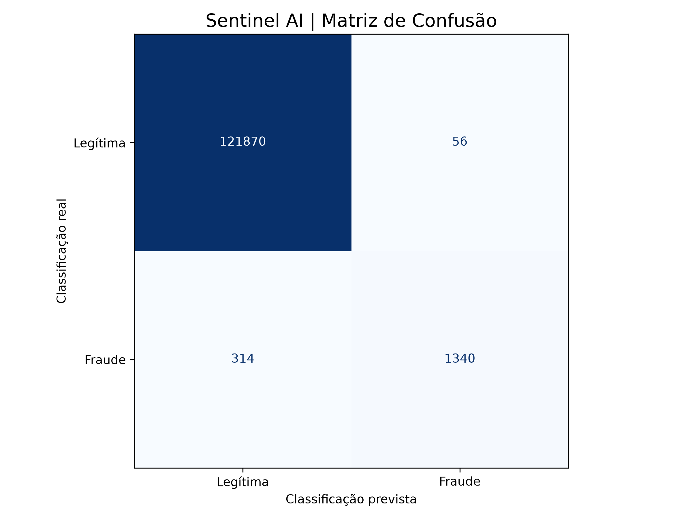
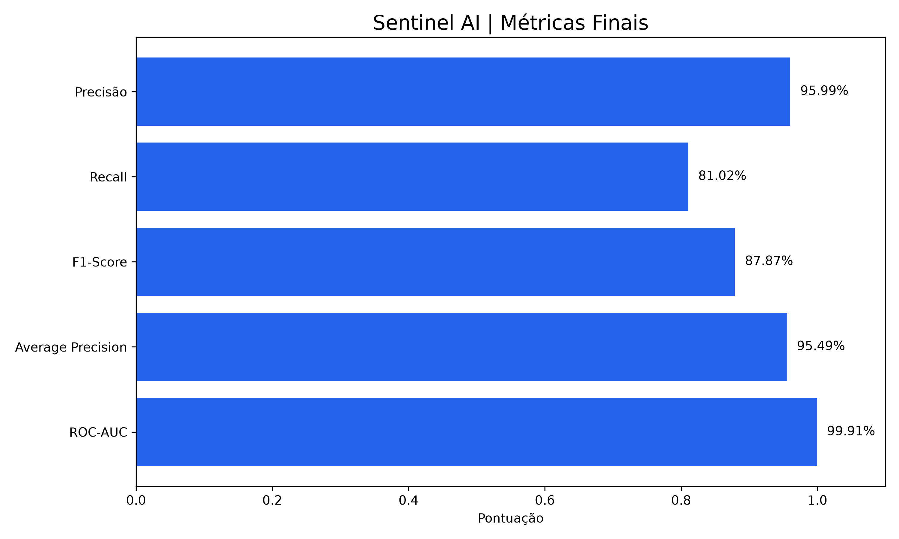
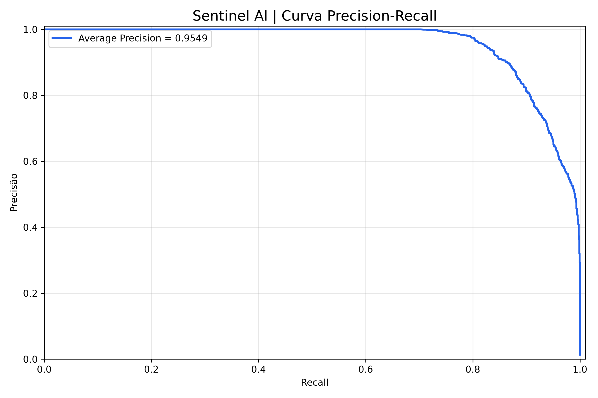
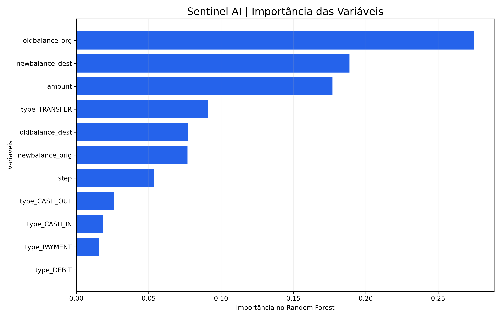

# Sentinel AI — Detecção de Fraudes Financeiras

Sistema de análise de transações financeiras e detecção de fraudes utilizando Python, PostgreSQL e Machine Learning.

## Objetivo

Desenvolver um modelo de Machine Learning capaz de identificar transações potencialmente fraudulentas, utilizando dados simulados de operações financeiras.

## Tecnologias

- Python
- PostgreSQL
- Pandas e NumPy
- Scikit-learn
- Matplotlib
- SQLAlchemy
- Random Forest

## Dataset

PaySim — Dataset sintético de transações financeiras.

- 6.362.620 transações
- 8.213 fraudes identificadas no dataset
- 743 etapas temporais

## Metodologia

1. Importação e armazenamento dos dados no PostgreSQL.
2. Análise exploratória dos dados.
3. Preparação das variáveis.
4. Divisão temporal em treinamento, validação e teste.
5. Treinamento do modelo Random Forest.
6. Seleção do threshold utilizando o conjunto de validação.
7. Avaliação final em dados de teste separados.

## Resultados

| Métrica            | Resultado |
| ------------------ | --------- |
| Acurácia           | 99,70%    |
| Precisão (fraudes) | 95,99%    |
| Recall (fraudes)   | 81,02%    |
| F1-Score (fraudes) | 87,87%    |
| Average Precision  | 95,49%    |
| ROC-AUC            | 99,91%    |

Threshold selecionado: 0.7.

### Matriz de confusão

- Verdadeiros negativos: 121.870
- Falsos positivos: 56
- Falsos negativos: 314
- Verdadeiros positivos: 1.340

## Visualizações

## Limitações

Os resultados foram obtidos utilizando dados sintéticos do PaySim.

O modelo ainda não foi validado em transações bancárias reais. Sua utilização em produção exigiria testes adicionais, monitoramento e avaliações de segurança.

## Relatório técnico

Consulte `docs/relatorio_modelo_final.md` para os resultados detalhados.
